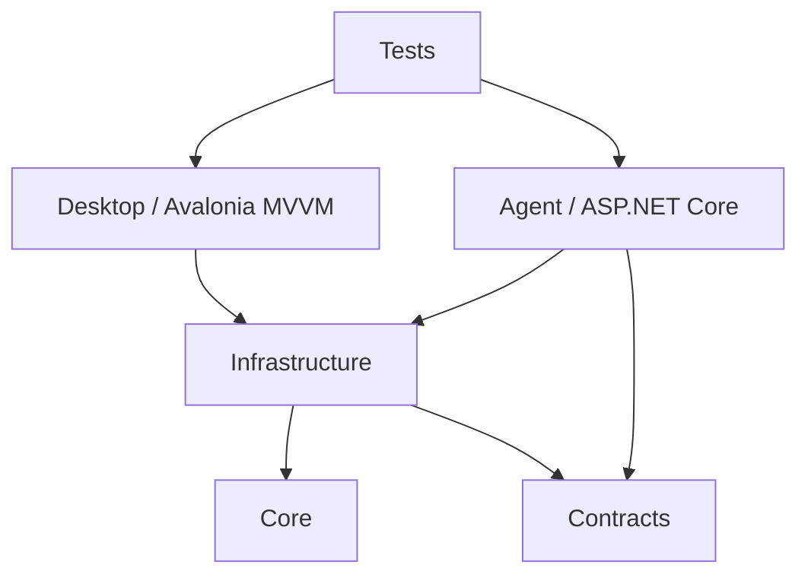
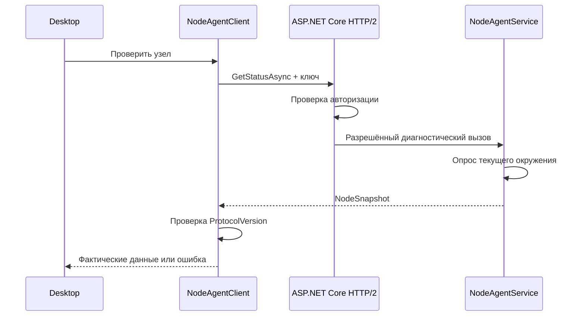
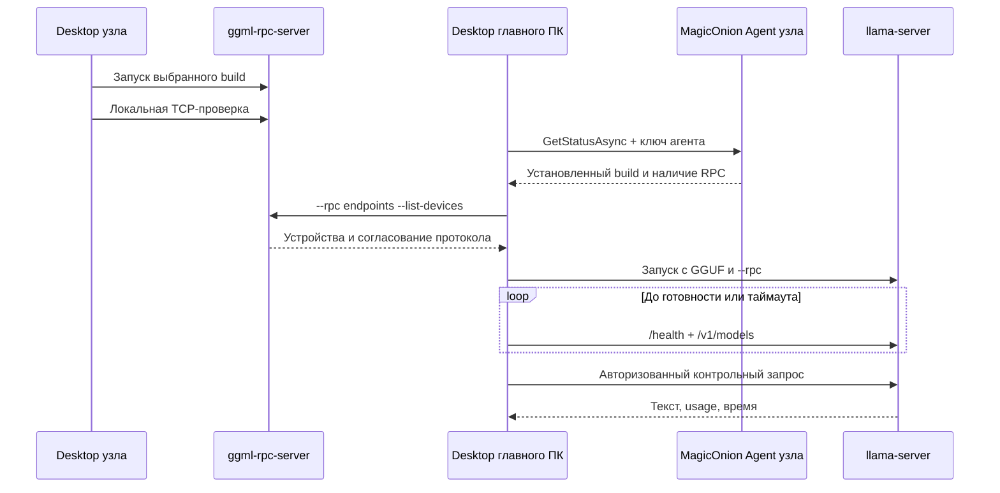

# Архитектура Open LLM Cluster

## Состав решения

| Проект | Назначение |
| --- | --- |
| [OpenLLMCluster.Core](src/OpenLLMCluster.Core) | Профиль, роли, проверки, подготовка аргументов запуска |
| [OpenLLMCluster.Contracts](src/OpenLLMCluster.Contracts) | Контракт INodeAgent и MessagePack DTO |
| [OpenLLMCluster.Infrastructure](src/OpenLLMCluster.Infrastructure) | Хранилища профиля/сборок, установщики, процессы, API, диагностика и MagicOnion-клиент |
| [OpenLLMCluster.Agent](src/OpenLLMCluster.Agent) | ASP.NET Core: диагностическая служба HTTP/2 / MagicOnion и отдельный HTTP inference-шлюз |
| [OpenLLMCluster.Desktop](src/OpenLLMCluster.Desktop) | Avalonia, представления, MVVM, темы и локализация |
| [OpenLLMCluster.Tests](tests/OpenLLMCluster.Tests) | Проверки домена, установки, процессов, настоящего сетевого обмена и XAML |
| [OpenLLMCluster.EngineFixture](tests/OpenLLMCluster.EngineFixture) | Тестовый дочерний CLI/TCP/HTTP-процесс, имитирующий состояния движка без LLM; не включается в публикацию |

Целевая платформа — .NET 10. Avalonia и сетевые библиотеки поддерживают Windows, Linux и macOS. Нативная работа на каждой ОС требует отдельной проверки; сборка из Windows её не заменяет.

## Зависимости

Core не зависит от UI, gRPC или конкретного ускорителя. Contracts не зависит от Avalonia. Desktop не использует серверные классы агента.

OpenAI-compatible client подключается к API кластера на главном ПК. Выбранный API-порт обслуживает отдельный процесс inference-шлюза из Agent. Он проверяет Bearer-ключ и Effort, затем передаёт запрос локальному llama-server на автоматически выделенном loopback-порту. Desktop управляет обоими процессами, сам HTTP не обслуживает. Диагностические порты Agent и вычислительные RPC-порты не являются адресами inference API.

## Рабочие компоненты

- [RouterProfile](src/OpenLLMCluster.Core/RouterProfile.cs) хранит настройки и адреса; паролей и токенов в схеме нет.
- [RuntimePlanner](src/OpenLLMCluster.Core/RuntimePlanner.cs) проверяет профиль и строит аргументы. Исполняемый файл выбирается по роли и ОС. Оболочка и внешние процессы не запускаются.
- [ProfileStore](src/OpenLLMCluster.Infrastructure/ProfileStore.cs) использует пользовательский каталог LocalApplicationData. Повреждённый профиль не подменяется молча.
- [LocalInstallationDiscovery](src/OpenLLMCluster.Infrastructure/LocalInstallationDiscovery.cs) ищет локальные каталоги движка и моделей в известных расположениях и PATH, читает downloadsFolder LM Studio. Поиск не исполняет бинарные файлы и не подтверждает совместимость RPC. Desktop показывает результаты по роли, сохраняет ModelDirectory в профиле и использует его как начальную папку выбора GGUF. Команды общего журнала копируют снимок записей и очищают Events и EngineEvents без остановки процессов; отдельные команды журнала llama.cpp работают только с EngineEvents. Оба пути копирования используют общее маскирование известных ключей.
- [EnvironmentProbe](src/OpenLLMCluster.Infrastructure/EnvironmentProbe.cs) возвращает реальные данные среды и ограничивает время работы nvidia-smi. Дополнительные поля NodeSnapshot сообщают последний установленный build/backend и наличие RPC из current.json; агент читает свой локальный каталог при каждом запросе.
- [NodeAgentClient](src/OpenLLMCluster.Infrastructure/NodeAgentClient.cs) выполняет GetStatusAsync с тайм-аутом, ключом и проверкой версии протокола; TLS проверяет закреплённый SHA-256 и срок действия сертификата для конкретного узла. Методы управления используют тот же канал и отдельный контракт INodeControl.
- [RpcController](src/OpenLLMCluster.Agent/RpcController.cs) последовательно запускает, останавливает и читает журнал собственного RPC из current.json. Клиент задаёт только IP и порт; пути и команды не принимаются. NodeControlService разрешает операции лишь при включённых TLS, AllowRemoteControl и ключе от 24 символов; занятый чужой порт не перехватывается.
- [AgentCertificateStore](src/OpenLLMCluster.Infrastructure/AgentCertificateStore.cs) хранит постоянную самоподписанную идентичность в защищённом хранилище. Windows импортирует ключ во временный пользовательский контейнер для SChannel; контейнер удаляется при Dispose сертификата. Отпечаток передаётся пользователем по отдельному доверенному каналу, автоматического доверия незнакомому сертификату нет.
- [ProtectedSecretStore](src/OpenLLMCluster.Infrastructure/ProtectedSecretStore.cs) шифрует ключи отдельно от профиля: DPAPI текущего пользователя Windows или AES-GCM с Unix-файлом ключа 0600 и каталогом 0700. Unix-хранилище не интегрировано с системным keychain.
- [MainWindowViewModel.Secrets](src/OpenLLMCluster.Desktop/ViewModels/MainWindowViewModel.Secrets.cs) восстанавливает ключи только при включённых RememberSettings и RememberAgentKeys. При сохранении удаляет значения исключённых узлов; выключенное сохранение ключей очищает набор, выключенный общий переключатель вообще не читает и не пишет его.
- [MainWindowViewModel.Remote](src/OpenLLMCluster.Desktop/ViewModels/MainWindowViewModel.Remote.cs) связывает UI сопряжения, удалённого старта/остановки и чтения журнала. Запуск агента и разрешение управления на узле остаются явными действиями пользователя.
- [LocalAgentHost](src/OpenLLMCluster.Infrastructure/LocalAgentHost.cs) запускает отдельный агент из подкаталога `Agent`, передаёт ключ через окружение, подтверждает готовность запросом MagicOnion и завершает только принадлежащий Desktop процесс.
- [AspNetRuntimeMissingException](src/OpenLLMCluster.Infrastructure/AspNetRuntimeMissingException.cs) распознаёт отсутствие или несовместимую версию `Microsoft.AspNetCore.App` и `Microsoft.NETCore.App` в завершившемся apphost и сохраняет требуемую архитектуру. Перед разбором LocalAgentHost дожидается чтения stdout/stderr, чтобы сообщение короткоживущего процесса не терялось.
- [AspNetRuntimeInstaller](src/OpenLLMCluster.Infrastructure/AspNetRuntimeInstaller.cs) получает метаданные стабильной ветки 10.0 с Microsoft, выбирает согласованную пару установщиков Windows нужной архитектуры, проверяет обе SHA-512 и запускает через UAC сначала .NET, затем ASP.NET. Коды отмены и требования перезагрузки обрабатываются отдельно. Интерфейс IAspNetRuntimeInstaller позволяет проверять UI без изменения runtime системы.
- [NetworkPortProbe](src/OpenLLMCluster.Infrastructure/NetworkPortProbe.cs) проверяет локальные и удалённые TCP-порты с тайм-аутом и перечисляет адреса активных интерфейсов. Успех TCP не означает успешную авторизацию или готовность RPC.
- [WindowsFirewall](src/OpenLLMCluster.Infrastructure/WindowsFirewall.cs) по команде пользователя запускает PowerShell с UAC. Создаёт/обновляет собственное правило выбранного порта: Inbound / TCP / Private / LocalSubnet. Произвольные пользовательские строки в скрипт не подставляются.
- [Agent.Program.Build](src/OpenLLMCluster.Agent/Program.cs) создаёт один сервер для штатного запуска и интеграционных тестов. Настраивает HTTP/2, ограничения сетевого режима и проверку ключа.
- [NodeAgentService](src/OpenLLMCluster.Agent/NodeAgentService.cs) реализует диагностический контракт; ReadAsync выполняется на компьютере агента.
- [MainWindowViewModel](src/OpenLLMCluster.Desktop/ViewModels/MainWindowViewModel.cs) координирует пользовательские действия. Изменение параметров или списка узлов сбрасывает старый предпросмотр.
- [MainWindowViewModel.Agent](src/OpenLLMCluster.Desktop/ViewModels/MainWindowViewModel.Agent.cs) связывает настройки локального агента, генерацию ключа, запуск/остановку, проверки портов и команду брандмауэра. Закрытие окна отменяет незавершённый запуск и останавливает собственный агент.
- [ModelSettings](src/OpenLLMCluster.Core/ModelSettings.cs) хранит параметры генерации, reasoning и памяти, проверяет диапазоны до построения CLI. RuntimePlanner форматирует десятичные числа invariant culture.
- [MainWindowViewModel.Model](src/OpenLLMCluster.Desktop/ViewModels/MainWindowViewModel.Model.cs) связывает редакторы с профилем/CLI и показывает копируемую справку Effort из фактического `/props`. Выбора уровня в Desktop нет; устаревшее поле профиля игнорируется, CLI всегда использует default. Служебные маркеры шлюза обновляют краткий статус возле Model ID без текста запроса.
- [ClusterDevicePlanner](src/OpenLLMCluster.Infrastructure/ClusterDevicePlanner.cs) сверяет локальный build и опрашивает настоящие RPC-устройства; пропорции вычисляются из объявленной свободной памяти минус резерв. ModelSettings хранит явный порядок Devices и TensorSplit, RuntimePlanner передаёт --device/--tensor-split. Это начальное распределение, не полный расчёт весов/KV-cache.
- [MainWindowViewModel.Cluster](src/OpenLLMCluster.Desktop/ViewModels/MainWindowViewModel.Cluster.cs) сверяет build агентов перед подбором, показывает устройства и выполняет два одинаковых тестовых запроса. Prompt/generation timing и скорость читаются из серверного ответа отдельно от HTTP-времени; отсутствие полей не превращается в ноль.
- [CpuLoadProbe](src/OpenLLMCluster.Infrastructure/CpuLoadProbe.cs) получает общесистемную нагрузку: разница GetSystemTimes на Windows, /proc/stat на Linux, интервальный top на macOS. Первый счётчик без интервала возвращает null.
- [MainWindowViewModel.Monitor](src/OpenLLMCluster.Desktop/ViewModels/MainWindowViewModel.Monitor.cs) опрашивает локальный probe и настроенные агенты параллельно, без пересечения циклов. MonitorIntervalSeconds выбирается из 1/2/3/5/10/15/30/60, сохраняется в RouterProfile и немедленно меняет DispatcherTimer.Interval; старое или неподдерживаемое значение возвращается к 3. Таймер работает после показа окна и останавливается при закрытии; запросы отменяются общим lifetime. Недоступный узел не блокирует применение успешных снимков других ПК.
- [MainWindowViewModel.Loading](src/OpenLLMCluster.Desktop/ViewModels/MainWindowViewModel.Loading.cs) показывает фактические этапы из вывода llama.cpp, измеряет время отдельным таймером и завершает индикатор только после подтверждённой готовности API. Процент загрузки весов не имитируется: в b12318 callback загрузки используется для связи дочернего процесса с router, а не для обычного HTTP-сервера — [server.cpp](https://github.com/ggml-org/llama.cpp/blob/b12318/tools/server/server.cpp#L679), [server-context.cpp](https://github.com/ggml-org/llama.cpp/blob/b12318/tools/server/server-context.cpp#L1180).
- Закрытие MainWindow сначала учитывает отмену Window.Closing, затем через TryStopEngineForClose подтверждает остановку собственного движка. Ошибка остановки отменяет закрытие и сохраняет владение процессом. EngineProcessHost синхронизирует старт/остановку, проверяет владельца и поколение запуска после подготовки ProcessStartInfo, дожидается выхода дерева процессов и только затем очищает его дескриптор. Dispose сбрасывает состояние модели и останавливает оба UI-таймера.
- [ComputerLoadViewModel](src/OpenLLMCluster.Desktop/ViewModels/ComputerLoadViewModel.cs) хранит отдельную карточку ПК и его GPU, время снимка и состояние. При ошибке скрывает старые числа, сохраняя отметку последнего успешного обновления. Ответ опроса не применяется после смены адреса/идентичности узла; неизвестная занятая VRAM обозначается -1 и не показывается как нулевая. Ошибки повторных опросов не накапливаются в журнале.
- [Localizer](src/OpenLLMCluster.Desktop/Services/Localizer.cs) уведомляет индексные привязки при смене языка. Режим system стоит первым и выбран по умолчанию; он использует CurrentUICulture интерфейса ОС: ru выбирает русский, остальные культуры — английский. В профиле сохраняется system, а не разрешённый язык. Подписи выбранных элементов ComboBox обновляются отдельными наблюдаемыми моделями.
- [ApplicationInfo](src/OpenLLMCluster.Desktop/Services/ApplicationInfo.cs) читает версию Desktop из AssemblyInformationalVersion без суффикса хеша и предоставляет единый заголовок окна. XAML использует её также рядом с названием приложения; версия не дублируется строкой в интерфейсе.
- Стиль `headerControl` в [App.axaml](src/OpenLLMCluster.Desktop/App.axaml) задаёт одинаковую высоту 40 для списков языка/темы и переключателя роли в верхней панели. Кнопки ручного сохранения в UI нет.

## Сетевой обмен первого этапа

Порты агента и вычислений независимы. Успешный GetStatusAsync не проверяет ggml-rpc-server и не загружает модель.

## Хранение и границы доверия

Профиль сохраняется автоматически при штатном закрытии, если включено запоминание настроек. [App](src/OpenLLMCluster.Desktop/App.axaml.cs) сначала читает отдельный `profile.json.startup.json` с флагом `RememberSettings`, затем при его включении загружает `profile.json` до создания видимого окна. При выключении профиль и набор ключей не читаются и не перезаписываются автоматически; флаг продолжает сохраняться. Старые профили без геометрии совместимы и получают исходные размеры окна.

[MainWindow](src/OpenLLMCluster.Desktop/Views/MainWindow.axaml.cs) восстанавливает размеры в логических единицах Avalonia, положение в экранных пикселях и состояние развёрнутого окна. Последние обычные размеры отслеживаются отдельно от развёрнутого/свёрнутого состояния. Отсутствующий монитор заменяется доступным. Небольшие JSON-файлы читаются синхронно перед показом окна и записываются синхронно в обработчике штатного закрытия: завершение приложения не опережает запись. Отменённое закрытие не сохраняет профиль; ошибка чтения не приводит к его перезаписи при закрытии.

Токены агентов, ключ inference API и результаты диагностики в профиль не включаются. Build/backend, число GPU-слоёв, таймаут и ModelSettings сохраняются вместе с остальным профилем. Конкретные адреса и пути задаются через UI и не входят в значения проекта по умолчанию. Принудительное завершение процесса не гарантирует автосохранение.

Профиль содержит `AgentSettings` с адресом, портом, LAN, TLS, разрешением управления и публичным отпечатком. Ключ генерируется криптографически, сохраняется только в отдельном защищённом наборе при разрешении пользователя и передаётся дочернему процессу через окружение. Пустой ключ LAN/управления генерируется при запуске; короткий ключ или сетевой адрес без явного разрешения LAN блокируют запуск. Параметры работающего агента редактируются после остановки. Автозапуск агента при открытии Desktop не выполняется. Постоянная TLS-идентичность хранится отдельно от переключателя пользовательских настроек.

В [проекте Desktop](src/OpenLLMCluster.Desktop/OpenLLMCluster.Desktop.csproj) цель после `Publish` публикует Agent с теми же Configuration, RuntimeIdentifier и SelfContained в подкаталог готового приложения. Desktop не ссылается на серверную сборку агента; процессы разделены.

Диагностический HTTP/2 без TLS сохранён для совместимости; контракт управления в нём запрещён. TLS включается явно и использует закрепление SHA-256 без доверия первому подключению. Для INodeControl одновременно требуются TLS, AllowRemoteControl и сильный ключ. Сравнение ключей выполняется без вывода значений в журнал. Защита канала управления не добавляет TLS в собственный вычислительный RPC llama.cpp.

Предпросмотр команды предназначен для просмотра массива аргументов и не является скриптом PowerShell, Bash или Zsh. Запуск выполняется отдельной командой UI после проверок.

## Установка и вычислительные процессы

- [LlamaPackageInstaller](src/OpenLLMCluster.Infrastructure/LlamaPackageInstaller.cs) использует явный официальный build-тег, по умолчанию b12318. Основной архив и CUDA-зависимости выбираются из одного релиза; SHA-256 GitHub проверяется до распаковки. Временный каталог находится внутри собственного хранилища, установка активируется после проверки CLI. Старые версии сохраняются. Повторная установка проверяет фактический build существующих бинарников без скачивания.
- [LlamaInstallationStore](src/OpenLLMCluster.Infrastructure/LlamaInstallationStore.cs) сохраняет манифест `open-llm-cluster-build.json` в каталоге исполняемых файлов и указатель `current.json` в пользовательском хранилище. Агент и Desktop одного пользователя видят последнюю выбранную установку. Другая учётная запись имеет отдельное хранилище.
- [EngineCommandRunner](src/OpenLLMCluster.Infrastructure/EngineCommandRunner.cs) проверяет `--help`, `--version` и перечисление RPC-устройств с таймаутом. Аргументы передаются через ArgumentList без оболочки.
- [ClusterBuildGuard](src/OpenLLMCluster.Infrastructure/ClusterBuildGuard.cs) сравнивает тег главного ПК и сведения агентов; отсутствие управляемого манифеста или RPC блокирует запуск кластера. Версия диагностического протокола остаётся 1: новые MessagePack-поля добавлены в конец DTO. Поля CPU/Gpus/SampledAt/TelemetryAvailable передают измерения; null означает отсутствие показателя. Старые агенты без телеметрии показывают требование обновления и не подменяют данные нулями.
- [EngineProcessHost](src/OpenLLMCluster.Infrastructure/EngineProcessHost.cs) перед стартом проверяет профиль, фактический build, свободный порт и устройства каждого RPC-адреса. Для перечисления аргументы идут в порядке `--rpc endpoints --list-devices`: CLI обрабатывает `--list-devices` немедленно. Затем создаётся вычислительный процесс текущей роли; Coordinator дополнительно запускает inference-шлюз из пакета Agent. Вычислительный backend слушает loopback, выбранный внешний порт принадлежит шлюзу. Предпросмотр RuntimePlanner показывает исходный CLI-план; host заменяет адрес и порт backend при управляемом запуске. Для Worker проверяются жизнь собственного процесса и TCP; для Coordinator — HTTP-готовность модели. Закрытие/отмена завершает собственные процессы модели и шлюза; завершение backend закрывает внешний порт. Для узла HTTP-шлюз не создаётся.
- [InferenceGatewayHost](src/OpenLLMCluster.Infrastructure/InferenceGatewayHost.cs) запускает Agent в отдельном режиме без MagicOnion. [InferenceGateway](src/OpenLLMCluster.Agent/InferenceGateway.cs) проверяет Bearer-ключ, передаёт HTTP/SSE фиксированному loopback-backend, сохраняет допустимый Effort клиента и удаляет неподдерживаемый. При неизвестных уровнях повторяет только HTTP 400 с ошибкой reasoning effort, один раз без Effort и до отправки ответа клиенту. Другие ошибки сохраняются. Ключ передаётся через окружение; журнал содержит только служебные маркеры. Desktop не получает дополнительную зависимость от ASP.NET Core; runtime нужен дочернему процессу Agent.
- [EngineApiClient](src/OpenLLMCluster.Infrastructure/EngineApiClient.cs) проверяет `/health` и авторизованный `/v1/models` с алиасом `open-llm-cluster`; 503 означает незавершённую загрузку. Контрольный `/v1/chat/completions` возвращает фактический текст, число токенов и длительность. Ключ передаётся в Bearer-заголовке.
- [MainWindowViewModel.Engine](src/OpenLLMCluster.Desktop/ViewModels/MainWindowViewModel.Engine.cs) связывает установку, выбор backend/build, управление процессом, отмену, ключ API, проверку модели и ограниченный журнал. Состояния не объявляют работающий процесс готовой моделью. Настройки роли блокируются до остановки. Статус переводится при смене языка.

Установка runtime выполняется через Desktop каждого ПК. Запуск/остановка RPC доступны локально либо удалённо через INodeControl после проверки TLS-идентичности и ключа. Агент не перехватывает процесс, запущенный другим владельцем. Загрузка GGUF и объём памяти не проверяются установщиком пакета; окончательную совместимость показывает реальный запуск.

Ключ inference API генерируется при пустом поле, передаётся процессу через `LLAMA_API_KEY`, не входит в аргументы или профиль и маскируется в журнале. Встроенный буфер процесса и журнал UI ограничены 500 строками. При перезапуске Desktop ключ вводится заново либо генерируется новый.

Правила Windows Firewall для Agent и RPC создаются отдельно, с именами `Open-LLM-Cluster-Agent-TCP-<port>` и `Open-LLM-Cluster-RPC-TCP-<port>`. Оба ограничены Private / LocalSubnet. Защита RPC не обеспечивается ключом API. Правило inference API, сторонний firewall и защищённый транспорт вычислительного RPC настраиваются вне приложения; TLS агента на эти контуры не распространяется.

## Локальные веса узла

[LocalModelManager](src/OpenLLMCluster.Agent/LocalModelManager.cs) принимает от главного ПК только [LocalModelIdentity](src/OpenLLMCluster.Contracts/LocalModelIdentity.cs): размеры и SHA-256 частей GGUF. Путь задаётся локально в AgentSettings и передаётся дочернему агенту через окружение. Метод INodeControl.PrepareLocalModelAsync использует существующее разрешение удалённого управления и TLS. NodeSnapshot сообщает о настроенной локальной копии; главный Desktop выполняет сверку до создания llama-server.

[RpcModelCache](src/OpenLLMCluster.Infrastructure/RpcModelCache.cs) проверяет отпечатки и подготавливает штатный кэш b12318. [NativeGgufLayout](src/OpenLLMCluster.Infrastructure/NativeGgufLayout.cs) читает только метаданные через ggml-base выбранной сборки, без выделения весов в RAM. Сырые тензоры больше порога протокола записываются потоково в RPC-кэш. Все управляемые Worker-процессы получают одинаковый локальный LLAMA_CACHE; при попадании по FNV-1a штатный RPC читает веса с диска. Метаданные кэша позволяют повторно использовать готовые файлы. Несовпадение SHA-256 блокирует запуск главного движка; отсутствие настроенного пути оставляет обычный RPC-режим.

## Документы

- [Обзор и запуск](README.md)
- [Подробная настройка и разработка](READEME-DEV.md)
- [Концепция продукта](CONCEPT.md)
- [Проверки](TEST-Project.md)
- [Задачи](TODO.md)
- [Журнал изменений](CHANGELOG.md)
