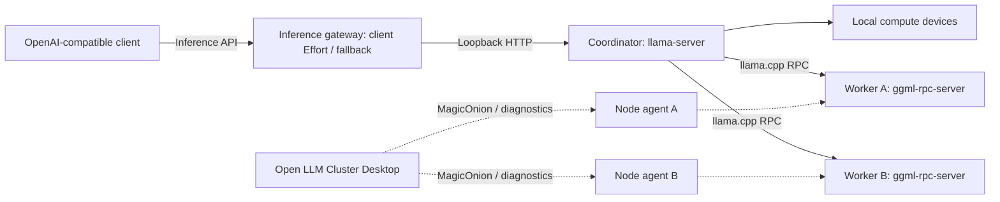

# Концепция Open LLM Cluster

## Назначение

Open LLM Cluster — кроссплатформенное настольное приложение для подготовки, проверки и управления распределённым запуском локальных языковых моделей на нескольких компьютерах.

Пользователь собирает кластер из главного компьютера и сетевых узлов. OpenAI-compatible client обращается к API Open LLM Cluster на главном компьютере. API обслуживает отдельный inference-шлюз из пакета Agent: он проверяет ключ и Effort клиента, затем передаёт запрос локальному llama-server. Desktop управляет обоими процессами. llama.cpp распределяет веса и вычисления между локальными и удалёнными устройствами через собственный RPC.

Документ описывает продукт без персональных характеристик оборудования, адресов компьютеров, имён пользователей, ключей и локальных путей из конкретного окружения.

## Роли компьютеров

| Роль | Обязанности |
| --- | --- |
| Главный компьютер / Coordinator | Хранит GGUF, запускает llama-server, подключает RPC-узлы, предоставляет API клиентам |
| Сетевой узел / Worker | Запускает ggml-rpc-server и предоставляет свои вычислительные устройства |
| Клиент | Отправляет запросы на API главного компьютера; не участвует в распределении весов |

Одно приложение поддерживает обе серверные роли. Выбор роли определяет необходимые файлы, проверки и аргументы запуска. Рабочая машина пользователя может одновременно быть главным компьютером и клиентом.

## Два независимых сетевых контура

**MagicOnion** отвечает за состояние узлов, проверки и ограниченные команды жизненного цикла RPC через TLS с закреплённым сертификатом. Он не заменяет вычислительный протокол llama.cpp.

**llama.cpp RPC** передаёт тензоры и вычислительные задания между движками. HTTP API LM Studio и LM Link не используются для объединения GPU в этой архитектуре.

Порт диагностического агента и порт вычислительного RPC различаются. Успешная проверка агента не означает, что RPC запущен, GGUF совместим или модель готова отвечать.

## Пользовательский сценарий

1. Выбрать язык, тему и роль текущего компьютера.
2. Установить одинаковый официальный build llama.cpp через UI на каждом ПК; главному компьютеру дополнительно выбрать GGUF.
3. Проверить локальное окружение и доступность необходимых файлов.
4. Добавить сетевые узлы с отдельными адресами управления и вычислений.
5. Проверить доступность агентов и совместимость их протокола.
6. Получить предварительный план запуска для выбранной роли.
7. На каждом сетевом узле локально запустить RPC, затем на главном ПК проверить build/устройства и запустить llama-server; дождаться /health и авторизованного /v1/models.
8. Получить параметры API для клиентского приложения и проверить контрольный запрос.

Каждая проверка должна показывать фактический результат и границы проверки. Обнаружение файла не равно подтверждению работоспособности. Приложение не должно показывать вымышленные GPU, скорость генерации или статус подключённой модели.

## Первый этап: реализованная основа

- Avalonia Desktop и MVVM на CommunityToolkit.Mvvm.
- Русский и английский интерфейсы с переключением во время работы.
- Светлая, тёмная и системная темы.
- Выбор роли и сохранение пользовательского профиля.
- Редактирование списка узлов; отдельное защищённое сохранение ключей агентов с учётом общего переключателя настроек.
- Определение ОС, доступных логических CPU, бюджета памяти среды .NET и данных NVIDIA через nvidia-smi.
- Проверка наличия runtime, сигнатуры и версии заголовка GGUF, адресов, портов и повторяющихся RPC-узлов.
- Предпросмотр аргументов llama-server или ggml-rpc-server без исполнения команд.
- Работающий диагностический агент MagicOnion и проверка его авторизации и версии протокола.
- Автоматическое включение Agent в публикацию Desktop, сетевые настройки и генерация ключа в UI, запуск/остановка локального диагностического агента с проверкой готовности.
- Проверки TCP-портов с локального и другого ПК; создание/обновление правила Windows Firewall для порта агента с ограничением Private / LocalSubnet.
- Установка закреплённого build llama.cpp и CUDA-зависимостей с проверкой SHA-256, хранением отдельных версий и проверкой CLI.
- Локальные кнопки запуска/остановки RPC и llama-server, отмена, журнал процессов, отдельное правило RPC Windows Firewall.
- Проверка одинакового build агентов, реальное перечисление RPC-устройств, ожидание /health и /v1/models, контрольный API-запрос.
- Автономные проверки профилей, планов, HTTP/2-обмена, пакетов, процессов и реального Avalonia XAML.
- Сопряжение с заранее сверенным SHA-256, TLS агента и удалённый запуск/остановка только собственного RPC из управляемой установки.
- Карточки CPU/NVIDIA GPU/VRAM каждого компьютера, сверка build и список настоящих RPC/CUDA-устройств, предложение пропорций с резервом памяти.
- Параметры генерации, Reasoning/Effort, KV-cache и batch в UI; два тестовых запроса с отдельными серверными prompt/generation timings.

Проверка GGUF на этом этапе читает только сигнатуру и версию формата. Она не проверяет таблицу токенизатора, тензоры, фактический предел контекста и поддержку архитектуры движком.

Бюджет памяти .NET не равен физическому объёму RAM и не используется как обещание вместимости модели. Опрос NVIDIA не перечисляет GPU других производителей.

## Следующие этапы автоматизации

### Развитие установки runtime

- Расширение каталога пакетов и ускорителей, включая Vulkan.
- Проверка драйверов и работоспособности GPU на каждой целевой ОС.
- Удалённое согласованное обновление runtime с использованием защищённого сопряжения.

Текущий установщик уже фиксирует общий build, проверяет источник/SHA-256 и CLI/RPC, сохраняет версии рядом и позволяет выбрать прежний тег для возврата. Установка выполняется локально на каждом ПК.

### Управление процессами

- Расширение списка разрешённых удалённых операций; запуск/остановка RPC и чтение его журнала уже реализованы.
- Обнаружение потери узла и понятный порядок перезапуска главного процесса.
- Автозапуск и фоновые службы после проверки ручного сценария.

### Проверки и мониторинг

- Полный разбор метаданных GGUF и диагностика повреждённых сборок.
- Расширенное сопоставление устройств с физическими адаптерами; перечисление CLI и начальные пропорции по свободной памяти уже реализованы.
- Проверка размещения весов, KV-кэша и фактически свободной памяти на каждом устройстве.
- Расширенные тестовые запросы и проверка финального ответа reasoning-моделей; базовый контрольный запрос уже реализован.
- Измерение загрузки модели и первого токена потокового ответа; серверные времена обработки входа и генерации уже отображаются для тестовых запросов.
- Сравнение локального запуска и кластера на одинаковых запросах.

## Сеть и доверие

Агент слушает только loopback по умолчанию. Для сетевого режима нужны явное разрешение LAN и ключ достаточной длины. TLS включается отдельно; главный ПК закрепляет полный SHA-256 сертификата, полученный с узла по доверенному каналу. Диагностический HTTP/2 без TLS сохранён для изолированного контура разработки и не разрешает управление процессами.

Удалённое управление требует TLS, проверенного сертификата, ключа от 24 символов и явного разрешения на узле. INodeControl принимает только параметры прослушивания RPC и не предоставляет произвольных команд или файловых путей. Агент управляет только своим RPC; установка runtime остаётся локальной.

Вычислительный RPC llama.cpp остаётся отдельным экспериментальным компонентом. Его нельзя публиковать в открытой сети. API-ключ inference-сервера не защищает RPC-порт.

## Ограничения производительности

Дополнительные GPU увеличивают доступную ёмкость для размещения весов, но не гарантируют ускорение одного ответа. Пропускная способность сети, задержки, архитектура модели, распределение слоёв и размер контекста влияют на результат.

Размеры памяти разных устройств нельзя считать полностью взаимозаменяемым общим пулом: отдельные буферы должны помещаться на конкретных устройствах. Увеличение контекста требует отдельной проверки KV-кэша и рабочих буферов.

## Критерии готовности продукта

Пользователь собирает конфигурацию через UI, получает объяснение каждой блокирующей ошибки, запускает согласованные runtime на выбранных узлах, видит подтверждённую готовность модели и подключает внешний клиент по показанным параметрам API.

Готовность отдельных этапов и ручная приёмка отражаются в [списке задач](TODO.md). Реализованные связи описаны в [архитектуре](ARCHITECTURE.md), проверки — в [документе тестирования](TEST-Project.md).

## Источники

- [llama.cpp: вычислительный RPC](https://github.com/ggml-org/llama.cpp/blob/master/tools/rpc/README.md)
- [llama.cpp: inference API и аргументы сервера](https://github.com/ggml-org/llama.cpp/blob/master/tools/server/README.md)
- [Avalonia](https://docs.avaloniaui.net/)
- [CommunityToolkit.Mvvm](https://learn.microsoft.com/dotnet/communitytoolkit/mvvm/)
- [MagicOnion](https://github.com/Cysharp/MagicOnion)
