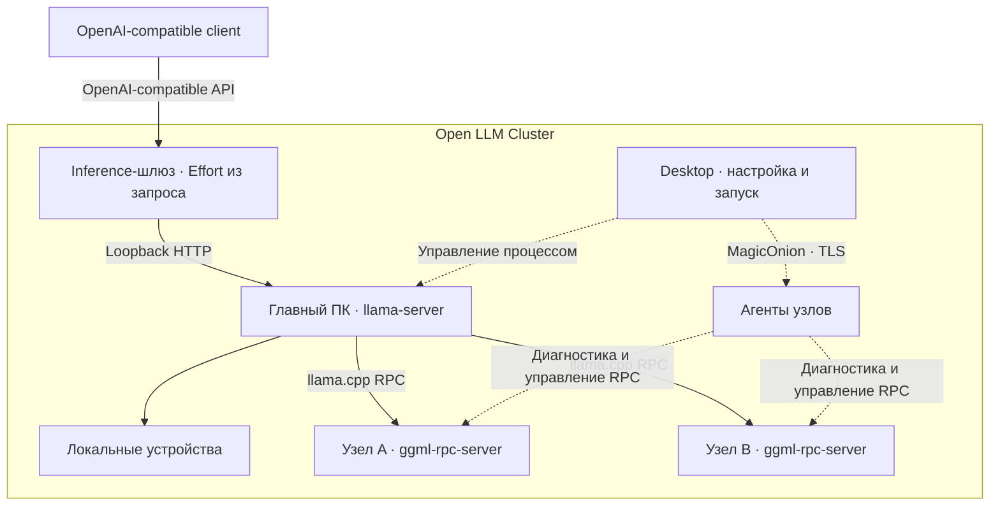
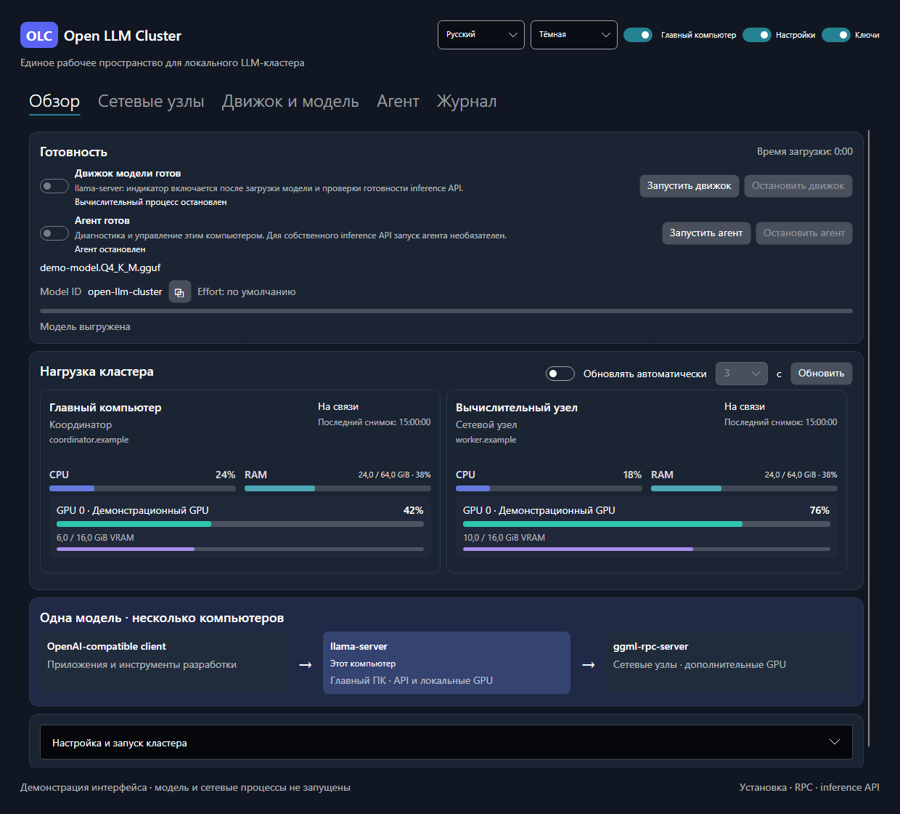
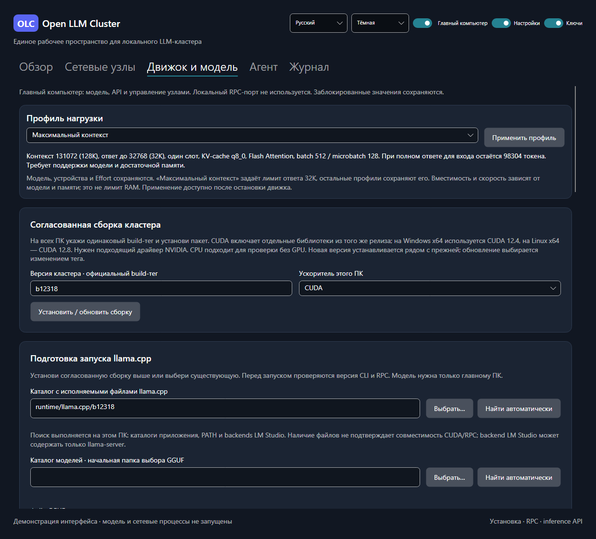
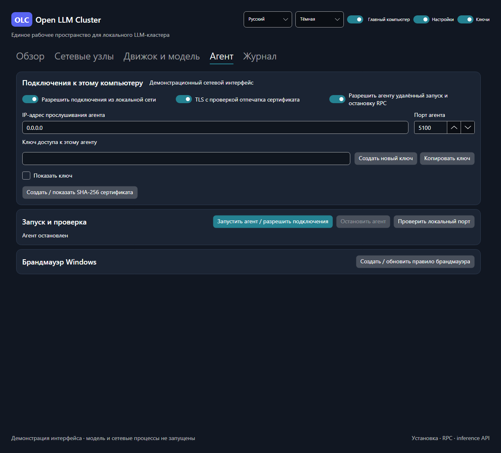

# Подробная настройка и разработка Open LLM Cluster

[На главную](README.md) · [Архитектура](ARCHITECTURE.md) · [Тестирование](TEST-Project.md)

Здесь собраны подробные инструкции по настройке кластера, модели и сети, а также сборке и разработке приложения. Для первого знакомства начни с [краткого руководства](README.md#быстрый-запуск).

## Содержание

- [Сборка и первый запуск из исходников](#быстрый-запуск)
- [Порядок запуска кластера](#запуск-кластера)
- [Подключение двух ПК](#подключение-двух-пк-через-desktop)
- [Параметры модели и мониторинг](#параметры-модели-и-нагрузка-компьютеров)
- [Профили нагрузки](#профили-нагрузки)
- [Локальная копия модели на узле](#локальная-копия-модели-на-узле)
- [RPC и порты](#rpc-и-порты)
- [Сопряжение и ключи](#защищённое-сопряжение-и-управление-rpc)
- [Восстановление runtime агента](#если-отсутствует-или-устарел-runtime-агента)
- [Сравнение с другими инструментами](#отличия-от-похожих-инструментов)
- [Проверки](#проверки) · [Публикация](#публикация)
- [Структура и документы](#структура-и-документы)

## Для чего нужен Open LLM Cluster

Приложение помогает задействовать вычислительные устройства нескольких компьютеров для запуска локальной языковой модели и подключить к ней **OpenAI-compatible client**.

- **Две роли в одном приложении:** главный компьютер с моделью и сетевые узлы с вычислительными устройствами.
- **Согласованный движок:** установка одной версии llama.cpp на всех ПК с проверкой пакетов и совместимости RPC.
- **Настройка модели:** GGUF, контекст, GPU-слои, KV-cache, sampling и доступные конкретному шаблону уровни Effort.
- **Проверяемый запуск:** диагностика узлов и устройств, журнал движка, этапы загрузки, проверка API и контрольный запрос.
- **Нагрузка по компьютерам:** CPU, системная RAM, NVIDIA GPU и VRAM отдельно для каждого узла.
- **Удобный Desktop:** светлая и тёмная темы, системный язык или явный выбор русского/английского, сохранение настроек и положения окна.

Проект рассчитан на Windows, Linux и macOS. Нативные проверки сейчас выполнялись на Windows; установку и работу на других ОС нужно проверять отдельно.

## Отличия от похожих инструментов

**Open LLM Cluster помогает запустить одну GGUF-модель на устройствах нескольких компьютеров через понятный Desktop-интерфейс.** Он автоматизирует установку согласованного llama.cpp, настройку ролей, запуск процессов, проверку связи и наблюдение за каждым ПК. Вычисления выполняет llama.cpp; возможности моделей и ускорителей зависят от выбранной сборки движка.

| Инструмент | Основной сценарий | Работа с несколькими компьютерами | Когда выбирать |
| --- | --- | --- | --- |
| **Open LLM Cluster** | Управление распределённым запуском GGUF через Desktop | Главный `llama-server` использует локальные и удалённые устройства через `ggml-rpc-server`; агенты обеспечивают диагностику и управление | Нужны одна модель на нескольких ПК, настройка через UI и видимость состояния каждого узла |
| **LM Studio / LM Link** | Поиск, загрузка, чат и API для локальных моделей; доступ к моделям на других устройствах | LM Link позволяет загрузить модель на выбранном устройстве и обращаться к ней с другого через защищённое соединение | Нужны готовый чат, каталог моделей и удобный доступ к модели на другом компьютере |
| **NVIDIA PAIR (Personal AI Router)** | Локальный маршрутизатор запросов с обнаружением и сопряжением ПК, управлением движками и мониторингом | Каждый независимый запрос целиком направляется подходящему узлу с нужной моделью и работающим движком; выбор учитывает доступность и нагрузку | Нужно распределять одновременные запросы AI-агентов между ПК, каждый из которых способен самостоятельно запустить нужную модель |
| **llama.cpp RPC вручную** | Прямое управление тем же вычислительным механизмом, который использует OLC | Пользователь самостоятельно устанавливает сборки, запускает RPC-узлы и задаёт устройства и распределение тензоров | Нужны CLI, собственные скрипты или полный контроль над запуском без Desktop |

**Ключевое отличие от NVIDIA PAIR — единица распределения работы.** В OLC llama.cpp распределяет тензоры и вычисления одной модели между устройствами нескольких ПК. В PAIR распределяются независимые запросы: каждый выполняется целиком на одном выбранном узле, где подготовлена модель. Поэтому OLC подходит для размещения одной большой модели на нескольких компьютерах, а PAIR — для параллельной работы с несколькими запросами на самостоятельных узлах. PAIR прямо указывает в документации, что не объединяет GPU-память и не разделяет одну модель между компьютерами. LM Link предоставляет удалённый доступ к модели, загруженной на выбранном устройстве.

**Практические границы OLC:** отдельный кластер Kubernetes для текущей схемы не требуется; встроенного чата и каталога скачивания моделей нет — GGUF выбирается из файлов, а диалог ведётся в OpenAI-compatible client. Балансировка запросов между независимыми репликами и автоматическое масштабирование сейчас не реализованы. Дополнительные компьютеры могут помочь разместить модель, но сетевые передачи способны увеличить задержку. Преимущество в скорости требует измерения на конкретной конфигурации; сравнительные бенчмарки этих инструментов в проекте не проводились.

Источники для сравнения: [API LM Studio](https://github.com/lmstudio-ai/docs/blob/main/1_developer/0_core/0_server/index.md), [LM Link](https://github.com/lmstudio-ai/docs/blob/main/5_lmlink/index.md) и [его FAQ](https://github.com/lmstudio-ai/docs/blob/main/5_lmlink/1_basics/faq.md), [NVIDIA PAIR](https://github.com/NVIDIA/Personal-AI-Router/blob/develop/README.md), [модель распределения запросов PAIR](https://github.com/NVIDIA/Personal-AI-Router/blob/develop/docs/overview.mdx#request-model), [llama.cpp RPC](https://github.com/ggml-org/llama.cpp/blob/master/tools/rpc/README.md). Это сравнение назначения и архитектуры по документации, а не результаты совместного нагрузочного тестирования.

## Как это работает



Клиент подключается к API **Open LLM Cluster** на главном компьютере: `http://<адрес-главного-ПК>:<порт-API>/v1`, model ID — `open-llm-cluster`. Выбранный API-порт обслуживает отдельный inference-шлюз из пакета Agent: он проверяет ключ, обрабатывает Effort и передаёт запрос локальному `llama-server` на автоматически выбранном loopback-порту. Desktop управляет обоими процессами; диагностический агент и его порт для запросов модели не используются.

GGUF находится на главном ПК, сетевые узлы предоставляют устройства через вычислительный RPC. Агенты MagicOnion отвечают за диагностику и управление узлами. Увеличение доступной памяти не гарантирует ускорения: результат зависит от модели, распределения тензоров и скорости сети.

### RPC и порты

**RPC (Remote Procedure Call, «удалённый вызов процедур»)** позволяет главному `llama-server` передавать вычислительные задания на видеокарты других ПК и получать результаты. На каждом сетевом узле эту работу принимает отдельный процесс `ggml-rpc-server`. Так части одной модели можно разместить на GPU нескольких компьютеров. Если модель работает только на главном ПК, удалённый RPC не требуется.

| TCP-порт по умолчанию | Где слушает | Назначение |
| --- | --- | --- |
| **8080 — API модели** | Главный ПК, inference-шлюз | Запросы OpenAI-compatible client к `/v1`; ключ inference API |
| **5100 — агент** | Каждый ПК с запущенным агентом | Диагностика, мониторинг и разрешённые команды управления через MagicOnion / HTTP/2; ключ агента, TLS при включении |
| **50052 — вычислительный RPC** | Сетевой узел, `ggml-rpc-server` | Задания от главного `llama-server` для удалённых GPU и результаты вычислений |

Порты можно изменить в интерфейсе; адреса и порты в настройках главного ПК должны совпадать с настройками узлов. **Работающий Desktop или доступный агент ещё не означают, что RPC запущен:** для распределённой модели нужен работающий `ggml-rpc-server` на каждом включённом узле. Дополнительная GPU-память помогает разместить большую модель, а скорость ответа зависит в том числе от обмена данными по сети.

## Документация

| Раздел | Ссылки |
| --- | --- |
| **Начало** | [Быстрый запуск](#быстрый-запуск) · [Запуск кластера](#запуск-кластера) · [Подключение двух ПК](#подключение-двух-пк-через-desktop) |
| **Настройка** | [Модель и мониторинг](#параметры-модели-и-нагрузка-компьютеров) · [Сопряжение и RPC](#защищённое-сопряжение-и-управление-rpc) · [RPC и порты](#rpc-и-порты) |
| **Проект** | [Концепция](CONCEPT.md) · [Задачи](TODO.md) · [Журнал изменений](CHANGELOG.md) |
| **Разработка** | [Архитектура](ARCHITECTURE.md) · [Тестирование](TEST-Project.md) · [Публикация](#публикация) · [Лицензия MIT](LICENSE.md) |

## Скриншоты

Настоящее окно Avalonia Desktop: **тёмная тема, русский язык, демонстрационные данные**. Названия узлов, адреса, модель и показатели нагрузки приведены для иллюстрации интерфейса; это не результаты измерения производительности. Вычислительные процессы в этой демонстрации не запущены.

<p align="center">
  <a href="Assets/Screenshots/overview-dark-ru.png"></a>
</p>
<p align="center"><sub>Обзор · состояние модели и нагрузка каждого компьютера</sub></p>

<details>
<summary>Движок и модель · профиль нагрузки и настройка запуска</summary>



</details>

<details>
<summary>Агент · сетевое подключение, TLS и брандмауэр</summary>



</details>

## Текущее состояние

Реализованы UI и профиль, диагностика MagicOnion, установка согласованной сборки llama.cpp, локальный запуск RPC/llama-server, TLS с закреплением сертификата и удалённое управление RPC через агент. Доступны защищённое сохранение ключей, мониторинг CPU/RAM/GPU по компьютерам, проверка build и настоящих RPC-устройств, предложение пропорций распределения по памяти и отдельные замеры обработки входа/генерации.

Подробное описание продукта находится в [CONCEPT.md](CONCEPT.md).

## Требования

- .NET SDK 10 или новее; приложение нацелено на .NET 10.
- Windows, Linux или macOS с поддержкой Avalonia Desktop.
- Для framework-dependent пакета с Agent: обычный .NET Runtime 10 и ASP.NET Core Runtime 10 согласованной версии; для разработки достаточно SDK.
- Для информации о NVIDIA GPU: установленный драйвер и доступный через PATH nvidia-smi.
- Для CUDA: совместимый драйвер NVIDIA; библиотеки CUDA скачиваются вместе с выбранной сборкой. Системный CUDA Toolkit установщику не требуется.
- Для генерации: совместимый GGUF на главном ПК и достаточно RAM/VRAM. Веса модели автоматически не скачиваются. Сам UI не требует установленной LLM.

## Быстрый запуск

Для разработки установи [Git](https://git-scm.com/downloads) и [.NET SDK 10 или новее](https://dotnet.microsoft.com/download/dotnet/10.0). Нужен именно SDK, одного Runtime недостаточно. Клонируй репозиторий, восстанови зависимости, собери решение, выполни тесты и запусти Desktop:

```shell
git clone https://github.com/DamianMorozov/Open-LLM-Cluster.git
cd Open-LLM-Cluster
dotnet restore Open-LLM-Cluster.slnx
dotnet build Open-LLM-Cluster.slnx -c Release
dotnet test --solution Open-LLM-Cluster.slnx -c Release --no-build
dotnet run --project src/OpenLLMCluster.Desktop -c Release --no-build
```

Команды выполняются из корня клона, рядом с `Open-LLM-Cluster.slnx`. Если скачал исходники через **Code → Download ZIP**, распакуй архив и открой терминал в каталоге решения, начиная с `dotnet restore`. Для запуска интерфейса модель и llama.cpp не нужны. В IDE открой решение и выбери стартовым проектом `OpenLLMCluster.Desktop`.

Сборка Desktop копирует Agent в свой выходной каталог: он используется как диагностическая служба и отдельный inference-шлюз. Для запуска главного сервера нужен ASP.NET Core Runtime 10; сам интерфейс Desktop сохраняет обычную зависимость от .NET Runtime. Для отдельной отладки диагностического агента выполни `dotnet run --project src/OpenLLMCluster.Agent -c Release --no-build`; настройка ключа и подключение описаны в [разделе разработки агента](#отдельный-запуск-для-разработки). Сборка для разработки не публикует релиз.

Команды публикации создают `Releases/Desktop` **на один уровень выше каталога решения**. При решении в `Sources` это соседняя папка в корне клона; при решении в корне клона — папка рядом с клоном. Файлы сборки и публикации не входят в репозиторий.

В интерфейсе выбери роль компьютера. На вкладке «Движок и модель» установи закреплённую сборку, затем выполни [порядок запуска кластера](#запуск-кластера). Кнопка предпросмотра только проверяет файлы и показывает аргументы; фактический запуск выполняется отдельно.

В верхней строке находятся переключатели «Настройки» и «Ключи». Первый управляет запоминанием настроек между запусками и включён по умолчанию; полные пояснения доступны в подсказках. При штатном закрытии сохраняются язык, тема, положение и размеры окна, состояние развёрнутого окна, роль, параметры runtime/модели/API/RPC и список узлов. При запуске они восстанавливаются до показа окна. Свёрнутое окно восстанавливается обычным или развёрнутым; положение вне доступных мониторов возвращается на рабочий экран.

Если переключатель выключен, профиль при запуске не читается и при закрытии не записывается; приложение стартует с исходными настройками. Сам переключатель запоминается отдельно в `profile.json.startup.json`, чтобы этот режим сохранялся между запусками. Ранее сохранённый `profile.json` остаётся на диске. Повторное включение начинает сохранять текущие настройки при следующем закрытии. Кнопка ручного сохранения удалена: автоматическим сохранением и восстановлением управляет только этот переключатель.

Настройки находятся в пользовательском каталоге LocalApplicationData / `Open-LLM-Cluster`; полный путь к `profile.json` показан на вкладке «Журнал». Сохранение ключей агентов и inference API включается общим переключателем «Ключи»; они восстанавливаются между сеансами при включённых «Настройки» и «Ключи». Конкретные адреса, пути и параметры пользовательского оборудования не включены в проект. Автосохранение рассчитано на штатное завершение; принудительное завершение процесса его не вызывает.

## Параметры модели и нагрузка компьютеров

Название, язык, тема, роль и переключатели запоминания выровнены по одной вертикальной середине. Роль находится после выбора темы: переключатель включён для главного компьютера, выключен для сетевого узла. Во время работы движка роль заблокирована до его остановки. Сохранение при закрытии и восстановление при открытии контролирует переключатель «Запоминать настройки между запусками».

Карточки «Обзор» и «Агент» используют компактные отступы и строки настроек: переключатель слева, подпись сразу справа. Такое же расположение используется для TLS сетевых узлов и Flash Attention. Сведения о CPU, системной RAM, каждом GPU, VRAM и времени измерения остаются отдельно для каждого компьютера. Подсказки у заголовков и настроек содержат подробные пояснения; описание этапов настройки раскрывается на «Обзоре».

Настройки блокируются по выбранной роли; введённые значения сохраняются и снова доступны при возврате к соответствующей роли.

| Настройки | Главный компьютер | Сетевой узел |
| --- | --- | --- |
| GGUF и каталог моделей, контекст, CPU-потоки, GPU-слои | Доступны | Заблокированы |
| API-порт, генерация, Effort, KV-cache, профиль нагрузки и распределение устройств | Доступны | Заблокированы |
| Список узлов, сопряжение, проверки и удалённое управление RPC | Доступны | Заблокированы |
| Локальный RPC-порт и правило его брандмауэра | Заблокированы | Доступны; правило создаётся на Windows |
| Сборка и каталог llama.cpp, адрес прослушивания, время ожидания запуска | Доступны | Доступны |
| Локальный агент, язык, тема, запоминание настроек, мониторинг и журнал | Доступны | Доступны |

Во время работы движка или операции с ним параметры запуска и переключатель роли заблокированы. Ограничения команд поиска моделей, проверки кластера и управления узлами применяются также через MVVM `CanExecute`, поэтому доступность кнопок обновляется сразу при смене роли.

На вкладке «Движок и модель» главному ПК доступны дополнительные параметры:

| Группа | Настройки |
| --- | --- |
| Генерация | Max Output Tokens (по умолчанию 4096), Temperature, Top K, Top P, Min P, Repeat Penalty |
| Рассуждения | Reasoning auto/on/off, копируемые доступные уровни Effort загруженной модели, бюджет reasoning |
| Память и обработка | Параллельные запросы, Batch/Microbatch, Flash Attention, тип KV cache K/V: f16, q8_0, q4_0 |

Все значения передаются в настоящие аргументы следующего запуска llama-server и сохраняются в профиле, если включено запоминание. Изменение параметров очищает прежний предпросмотр. Microbatch не может превышать Batch; квантованный V-cache требует включённого Flash Attention и поддержки конкретного backend. Встроенная проверка диапазонов не гарантирует, что выбранные значения поместятся в память или поддерживаются архитектурой GGUF; это проверяет движок.

**Effort в Desktop — справка с кнопкой копирования.** После загрузки `/props` сообщает доступные уровни шаблона; если подтверждённого списка нет, произвольный общий список не показывается. Например, `low, high` можно скопировать в настройки OpenAI-compatible client. Клиент задаёт уровень в каждом запросе: `reasoning_effort` для Chat Completions или `reasoning.effort` для Responses. Desktop всегда запускает движок с `--reasoning-effort default`; старое сохранённое значение не навязывается запросам.

Inference-шлюз сохраняет допустимое значение клиента. Отсутствующее, пустое или неподдерживаемое значение оставляет выбор шаблону: параметр удаляется, строка `default` в API не отправляется. Если `/props` не сообщил уровни, а движок вернул HTTP 400 с ошибкой reasoning effort, шлюз повторяет запрос один раз без Effort, до передачи ответа клиенту. Другие ошибки, включая переполнение контекста, передаются клиенту. Поток SSE сохраняется. Рядом с **Model ID** выводится состояние последнего обработанного запроса: Effort из клиента, по умолчанию или краткое сообщение о fallback. Значения ключей и текст запроса в это уведомление не включаются.

 Reasoning и Effort — разные настройки. Бюджет -1 не ограничен, 0 завершает рассуждения; поведение зависит от реализации модели. Выбор Effort не гарантирует ускорения.

### Профили нагрузки

На вкладке «Движок и модель» выбери профиль и нажми **«Применить профиль»** перед следующим запуском. Выбор в списке сам по себе параметры не меняет; во время работы движка применение заблокировано.

| Профиль | Общий контекст | Max Output Tokens | Слоты | Batch / microbatch | KV-cache |
| --- | ---: | --- | ---: | --- | --- |
| Быстрый отклик | 8192 | Сохранить текущий | 1 | 512 / 128 | Сохранить текущий |
| Сбалансированный | 16384 | Сохранить текущий | 1 | 512 / 128 | Сохранить текущий |
| Параллельные запросы | 16384 | Сохранить текущий | 2 | 1024 / 256 | Сохранить текущий |
| Максимальный контекст | 131072 (128K) | 32768 (32K) | 1 | 512 / 128 | Сохранить текущий |

Все четыре профиля сохраняют текущие типы KV-cache K/V и состояние Flash Attention и задают число CPU-потоков как половину логических процессоров, от 1 до 8. Резерв для подбора пропорций устройств — 1024 MiB, для параллельных запросов — 1536 MiB. В закреплённой сборке общий контекст при двух слотах делится на 8192 токена на слот. Резерв используется при следующем подборе пропорций; уже заданный tensor-split автоматически не пересчитывается.

Профили сохраняют выбранную модель, GPU-слои, устройства и их пропорции, сетевые адреса и sampling. «Максимальный контекст» устанавливает Max Output Tokens = 32768; остальные профили сохраняют текущий лимит ответа. В окно 131072 токенов входят и вход, и выход: для полного ответа 32768 вход должен занимать не более 98304 токенов, включая служебные сообщения и инструменты. Клиент настраивается на те же Context Window / Max Output Tokens. Нужны поддержка такого окна самой моделью и достаточная память. Применённый профиль запоминается вместе с настройками; ручное изменение охваченных им параметров возвращает отметку «Пользовательский». Исходные типы KV-cache — f16/f16. Это начальные конфигурации: совместимость выбранного кэша и Flash Attention и вместимость проверяются реальным запуском, жёсткого ограничения RAM они не устанавливают. Ускорение конкретной модели не гарантируется.

Большая история увеличивает обработку входа, а большой лимит ответа может надолго занять слот. При одном слоте следующий запрос ждёт завершения предыдущего. Для быстрого отклика ограничь также историю и длину ответа в OpenAI-compatible client; серверные значения по умолчанию могут быть переопределены клиентом.

Если RPC останавливается при обработке длинного запроса с ошибкой CUDA `an illegal memory access was encountered`, проверь KV-cache K/V. В распределённой проверке Flint на сборке b12318 кэш q8_0/q8_0 воспроизводил падение после 4096 входных токенов; замена только кэша на f16/f16 позволила обработать 6761 токен и получить ответ через шлюз. Уведомление о неподходящем Effort само по себе не останавливало движок. Перед повторной загрузкой восстанови RPC узла. Эти результаты относятся к проверенной конфигурации; f16 требует больше памяти, а заполнение всего окна 131072 в этом тесте не проверялось.

### Подбор распределения и замеры

На вкладке «Движок и модель» после запуска RPC узлов нажми **«Проверить кластер / устройства»**. Приложение сверит закреплённый build, выполнит `--rpc … --list-devices` и покажет идентификаторы и доступную память устройств. **«Подобрать пропорции»** повторяет проверку и заполняет поля `--device` и `--tensor-split`, сохраняя порядок CLI. Из свободной памяти каждого устройства вычитается настраиваемый резерв, по умолчанию 1024 MiB; устройства без остатка исключаются. Пропорции редактируются вручную и сохраняются в профиле. Пустые поля оставляют размещение движку.

В режиме GPU-слоёв **`-1` (авто)** передаются `--n-gpu-layers auto --fit on --fit-target <резерв-MiB>`. Движок подбирает количество слоёв и размещение по доступной памяти выбранных устройств. Поле tensor-split сохраняется, но в автоматическом режиме не передаётся: фиксированные пропорции также запрещают штатному fit перераспределять веса. При ручном числе слоёв пропорции снова применяются. Заданные контекст, число слотов и точность KV-cache сохраняются; при недостатке памяти часть слоёв может остаться на CPU, что замедлит генерацию.

Сообщение `n_gpu_layers already set by user to 99, abort` означает отказ автоматического подбора из-за фиксированных слоёв. Это предупреждение не обязательно останавливает загрузку: ищи итоговую ошибку, например `cudaMalloc failed: out of memory` и `failed to allocate buffer for kv cache`. Если авто не помогает, уменьши контекст или число одновременно обслуживаемых запросов; автоматический режим не гарантирует вместимость любого окна. Резерв устройств теперь используется и при штатном fit, и при ручном подборе пропорций.

Это начальная настройка по объявленной движком памяти, а не расчёт размещения всех тензоров и KV-cache или обещание ускорения. RPC может предоставлять CPU-память, если на узле установлена CPU-сборка. После изменения состава устройств заново выполни подбор. Нехватка памяти и поддержка архитектуры окончательно проверяются настоящей загрузкой модели.

Кнопка **«Измерить два запроса»** отправляет одинаковый prompt дважды, до 32 токенов каждый раз. Результат содержит вход, кэш, выход, общее HTTP-время, серверные `prompt_ms`, `predicted_ms` и скорость обработки/генерации. Отсутствующие timings обозначаются прочерком; HTTP-время не выдаётся за чистое время генерации. Кэш не сбрасывается, поэтому первый запрос тоже может оказаться частично закэшированным. Для сравнения локального запуска и кластера используй одинаковые модель, контекст и prompt; столь короткий замер не заменяет длительный benchmark.

Max Output и sampling задают значения сервера по умолчанию, **не жёсткий лимит внешнего клиента**. Клиент может отправить собственные max_tokens, temperature и другие значения; для ограничения длинного ответа настрой также OpenAI-compatible client. Размер окна включает входной контекст и генерируемый ответ, а при нескольких слотах распределяется движком согласно его правилам.

На вкладке «Обзор» для обеих ролей есть карточка **«Готовность»**. Заблокированные тоглы показывают подтверждённую готовность движка и локального агента; менять их вручную нельзя. Рядом находятся повторные кнопки «Запустить движок» / «Остановить движок» и «Запустить агент» / «Остановить агент», использующие те же команды и ограничения, что основные вкладки. На главном ПК движок — llama-server с загруженной моделью и готовым API; на узле — ggml-rpc-server с доступным локальным портом. Агент имеет отдельное состояние; его запуск на главном ПК необязателен для собственного inference API. При запуске, ошибке и остановке индикаторы отражают фактическое состояние процессов.

На главном ПК в этой карточке дополнительно показаны: имя GGUF, Model ID с кнопкой копирования, текущий этап и время загрузки. Для клиента, подключённого к серверу Open LLM Cluster, используй скопированный алиас `open-llm-cluster`: приложение явно задаёт его через `--alias`. У того же Flint через API LM Studio идентификатор может быть `recursivesi/flint`. Model ID зависит от сервера, а не только от GGUF; проверяй список `GET /v1/models` именно на адресе подключения клиента. Во время проверки движка/узлов, загрузки весов, подготовки контекста и прогрева отображается индикатор активности. В закреплённой сборке обычный llama-server не сообщает процент загрузки весов; приложение не рассчитывает его по времени. Полная полоса и статус готовности появляются только после успешных `/health` и авторизованного `/v1/models`. Отмена, ошибка и остановка сбрасывают готовность.

После загрузки карточка показывает доступную активность: ожидание запроса, обработку входного контекста или генерацию токенов, число активных слотов и счётчики входа/выхода. Диагностика `/slots` обновляется вместе с нагрузкой — автоматически или кнопкой «Обновить». Если сервер её не предоставляет, отображается отсутствие данных. Генерация включает рассуждения и финальный ответ: эта диагностика не различает их. Сдвиг KV-кэша отображается при соответствующей строке журнала; семантическое сжатие истории во внешнем клиенте здесь не наблюдается.

При штатном закрытии Desktop отменяет незавершённый запуск, завершает собственное дерево процессов llama-server/RPC и проверяет его завершение до закрытия окна. Так выгружается модель и освобождаются ресурсы её процесса. Позднее создание модели после закрытия владельца запрещено. Если процесс не удалось остановить, окно остаётся открытым и показывает ошибку. Отменённое пользователем закрытие не выгружает модель; чужие процессы не останавливаются.

Карточки нагрузки показывают каждый ПК отдельно: название узла, адрес агента, фактическое имя компьютера, состояние соединения, время последнего измерения, общую загрузку CPU, занятую/полную физическую RAM и её процент, каждый NVIDIA GPU с индексом/названием, процент нагрузки и занятую/полную VRAM. Рядом с «Обновлять автоматически» выбирается интервал **1, 2, 3, 5, 10, 15, 30 или 60 секунд**, по умолчанию 3. Таймер применяет выбранное значение сразу; если предыдущий опрос ещё выполняется, следующий пропускается. При выключенном автообновлении список недоступен, выбранные секунды сохраняются. Настройка записывается и восстанавливается вместе с профилем, если включено запоминание настроек. Старый профиль без интервала или с неподдерживаемым значением использует 3 секунды. Кнопка ручного запроса доступна отдельно. Этапы загрузки модели обновляются независимо от интервала мониторинга.

Для сетевых ПК требуется **обновлённый Agent из этой публикации**, запущенный на соответствующем узле, и ключ на вкладке «Сетевые узлы». Установка нового Desktop только на главном ПК не обновляет удалённого агента. Старый агент остаётся совместим для диагностики, но карточка попросит обновление вместо показа нулевой нагрузки. Неактивные узлы и узлы без ключа отмечаются отдельно. При потере связи прежние значения скрываются, время последнего успешного снимка сохраняется. Нагрузка — системная, а не доля процесса LLM.

RAM читается из системных счётчиков Windows и `MemAvailable` Linux; на macOS доступная память оценивается по свободным, неактивным и спекулятивным страницам. Старый агент без новых полей RAM показывает отсутствие измерения. Бюджет GC .NET не используется как физическая память.

CPU измеряется системными счётчиками Windows/Linux, на macOS — системным top. Первый снимок счётчиков может не содержать процента до накопления интервала. GPU измеряются через nvidia-smi; Apple/AMD/Intel GPU пока не опрашиваются. Недоступный показатель обозначается как отсутствие измерения, а не 0%.

Схема **«Одна модель · несколько компьютеров»** меняет фон при смене роли: синий оттенок для главного ПК и зелёный для сетевого узла. Соответствующий блок llama-server или ggml-rpc-server выделен и подписан «Этот компьютер». Цвета адаптируются к светлой и тёмной темам.

## Поиск локальных каталогов и журнал

На вкладке «Движок и модель» доступны две кнопки **«Найти автоматически»**:

- У каталога llama.cpp поиск проверяет текущий путь, каталог приложения, вложенные `runtime` и `llama.cpp`, `PATH` и `extensions/backends` известных каталогов LM Studio. Поиск ограничен этими расположениями; полный обход дисков не выполняется. Результаты перечисляются в списке с отдельными отметками наличия `llama-server` и `ggml-rpc-server`. Выбирается первый результат с исполняемым файлом текущей роли; можно выбрать другой. Если нужного файла нет, ручной путь не заменяется.
- У каталога моделей поиск читает только `downloadsFolder` из `settings.json` LM Studio и проверяет существующие стандартные каталоги. Существующий ручной каталог имеет приоритет. Настройки LM Studio не меняются, ключи из них не импортируются. Пустой старый файл настроек пропускается; повреждённый JSON даёт предупреждение и не блокирует остальные результаты.

Каталог моделей можно выбрать вручную. Он сохраняется вместе с профилем согласно переключателю запоминания; старые профили совместимы. Кнопка выбора файла GGUF начинает диалог в этом каталоге. Автопоиск не выбирает модель вместо пользователя и не читает её веса.

Наличие файлов не подтверждает совместимость CUDA, GGUF или сетевого RPC. В backend LM Studio может присутствовать только `llama-server`; для сетевого узла нужна отдельная совместимая сборка с `ggml-rpc-server`. Успешный запуск диагностического агента сам по себе вычислительный RPC не запускает.

Вкладка **«Журнал» расположена последней**, после «Агент». На ней кнопка **«Копировать журнал»** помещает текущие записи общего журнала и движка в буфер обмена, маскируя известные ключи текущего сеанса. **«Очистить журнал»** удаляет записи общего журнала и журнала движка, сохраняя настройки, результаты проверок и работающие процессы. Файлы журналов других программ не удаляются.

Кнопки копирования и очистки представлены значками справа от заголовка журнала; названия появляются в подсказках и доступны средствам доступности. У журнала llama.cpp на вкладке «Движок и модель» своя пара кнопок: она копирует или очищает только вывод движка, сохраняя общий журнал. Копирование обоих журналов маскирует известные ключи сеанса.

## Запуск кластера

### Одинаковая сборка на каждом ПК

1. Скопируй всю опубликованную папку Desktop на каждый участвующий компьютер, включая обновлённый `Agent`. Старый агент без сведений о сборке не пройдёт проверку кластера.
2. Открой «Движок и модель». В поле «Версия кластера» оставь **`b12318`** на всех ПК. Это закреплённый [официальный релиз](https://github.com/ggml-org/llama.cpp/releases/tag/b12318), а не автоматически меняющийся `latest`.
3. Выбери backend текущего ПК: CUDA для NVIDIA, CPU для проверки без GPU, Metal для macOS. Backend может различаться между узлами; build должен совпадать.
4. Нажми **«Установить / обновить сборку»**. Пакеты скачиваются с GitHub, проверяются по SHA-256 из метаданных релиза и распаковываются в пользовательское хранилище `LocalApplicationData / Open-LLM-Cluster / runtimes`. Для CUDA устанавливаются основной пакет и cudart того же релиза. Проверяются наличие обоих EXE, `--rpc` и фактический номер build. Каталог runtime выбирается автоматически.
5. Повтори на остальных ПК. Приложение не устанавливает пакеты удалённо. Существующая LM Studio и её backend не изменяются.

Для обновления останови вычислительные процессы, выбери одинаковый новый официальный build-тег на всех ПК и повтори установку. Новая версия получает отдельный каталог. Для возврата выбери прежний тег/backend и нажми установку: уже установленный каталог повторно проверяется без скачивания. Если GitHub не содержит нужного пакета или SHA-256, установка завершится понятной ошибкой; произвольная сборка не подставляется.

| Платформа | CUDA-пакет | Другие варианты |
| --- | --- | --- |
| Windows x64 | CUDA 12.4 + cudart | CPU |
| Windows arm64 | CUDA 13.5 + cudart | CPU |
| Linux x64 | Ubuntu CUDA 12.8 + cudart | CPU |
| Linux arm64 | Ubuntu CUDA 13.5 + cudart | CPU |
| macOS x64/arm64 | Не используется | Metal или CPU |

Наличие выбранного пакета проверяется в конкретном релизе. На Linux необходима совместимость с Ubuntu-бинарниками и их системными библиотеками. Успех проверки CLI подтверждает запуск бинарников, но не вместимость модели и не скорость CUDA.

### Сначала сетевые узлы

На каждом подключаемом ПК:

1. В верхней панели после темы выключи переключатель **«Главный компьютер»**: роль изменится на **«Сетевой узел»**.
2. На вкладке «Агент» включи LAN, запусти диагностический агент и разреши его порт по [инструкции ниже](#подключение-двух-пк-через-desktop). Скопируй ключ для главного ПК.
3. В «Движок и модель» после установки общей сборки задай адрес прослушивания **`0.0.0.0`** либо IP нужного интерфейса и порт RPC, по умолчанию **`50052`**. В обычном режиме для этой роли GGUF не нужен; для чтения весов с диска узла настрой [локальную копию модели](#локальная-копия-модели-на-узле). Адрес и порт агента на другой вкладке настраиваются отдельно.
4. Нажми **«Разрешить RPC в брандмауэре»** и подтверди UAC. Создаётся отдельное правило `Open-LLM-Cluster-RPC-TCP-<port>`: Inbound / TCP / Private / LocalSubnet. На Linux/macOS правило настраивается средствами ОС.
5. Нажми **«Запустить движок текущей роли»**. Появится статус RPC и журнал `ggml-rpc-server`. Этот статус означает работающий собственный процесс и открытый локальный TCP-порт; окончательная проверка RPC-устройств выполняется главным сервером.

RPC llama.cpp не имеет защиты ключом inference API и предназначен только для доверенной закрытой сети. Порт агента и RPC — разные порты; правило одного не открывает другой. Кнопка брандмауэра не меняет Kaspersky или другие сторонние сетевые фильтры.

### Локальная копия модели на узле

На странице **«Агент»** в роли **«Сетевой узел»** можно выбрать локальный GGUF. Для split-GGUF выбери файл `00001-of-…`: все части должны находиться рядом. Путь может отличаться от пути на главном ПК. При смене модели обнови выбор на участвующих узлах; пустое поле оставляет обычную передачу весов через RPC.

1. Останови агент и локальный движок, установи согласованную сборку llama.cpp.
2. Выбери GGUF в карточке **«Локальная копия модели для RPC»**. При желании заранее нажми **«Подготовить локальный кэш»**; подготовку можно отменить. Путь сохраняется вместе с настройками.
3. Запусти агент с TLS и разрешённым удалённым управлением, затем RPC. На главном ПК запусти движок как обычно.
4. Перед загрузкой главный ПК вычислит размер и SHA-256 всех частей своего GGUF. Каждый агент с выбранной локальной копией проверит все свои части и подготовит кэш. Различие размера, SHA-256 или количества частей остановит запуск с ошибкой. В сеть передаются только отпечатки, веса для подготовки читаются с диска узла.

Закреплённый `ggml-rpc-server` не принимает путь к GGUF. Приложение подготавливает его штатный дисковый кэш: библиотека той же сборки читает точные диапазоны тензоров, крупные тензоры сохраняются под протокольными FNV-1a именами. SHA-256 используется отдельно для проверки идентичности целых файлов. RPC запускается с `--cache` и `LLAMA_CACHE`, указывающим на пользовательский каталог LocalApplicationData / `Open-LLM-Cluster/rpc-cache/b12318`; тензоры лежат в подкаталоге `rpc`. Формат подготовки проверен для b12318.

Подготовка потребует дополнительного места на диске, сопоставимого с размером модели. При повторном запуске целые GGUF снова проверяются по SHA-256, а готовые файлы кэша используются повторно. В этой сборке кэш применяется к блокам весов **больше 10 MiB**; меньшие или преобразованные движком блоки могут передаваться по сети. Главному ПК по-прежнему нужен свой GGUF. Обмен активациями и вычислительными командами продолжается; эта настройка уменьшает трафик загрузки весов, а не устраняет сетевую зависимость генерации. Обычный RPC с `--cache` также сохраняет крупные веса после первой сетевой загрузки.

На узле нужны Desktop и Agent из новой сборки. Старый агент не сообщает о локальной копии и продолжает работать в прежнем режиме. Кнопка ручной подготовки не заменяет сверку с главным ПК: она подтверждает только чтение локальных файлов и готовность кэша. Результаты проверок и ограничения описаны в [TEST-Project](TEST-Project.md#локальная-копия-gguf-и-кэш-rpc).

### Затем главный компьютер

1. В верхней панели включи переключатель **«Главный компьютер»**. Установи тот же build и выбери GGUF; для многотомной модели укажи первый файл, остальные должны находиться рядом.
2. На вкладке «Сетевые узлы» добавь включённые узлы: адрес, порт агента, ключ агента и фактический RPC-порт. Выполни проверки агента и TCP RPC.
3. Начни с небольшого контекста, например `8192`, и одного запроса одновременно. Параллельность изменяется в дополнительных параметрах. Поле «Слоёв GPU» задаёт `--n-gpu-layers`: `-1` включает автоматический подбор, `0` оставляет веса на CPU, положительное значение фиксирует число слоёв. Для новых профилей исходное значение — `-1`; ранее сохранённые ручные значения не меняются. Распределение local/RPC выполняет llama.cpp в режиме `layer`; для начального подбора `--device` и `--tensor-split` используй [проверку устройств и подбор пропорций](#подбор-распределения-и-замеры).
4. Задай адрес API и порт, по умолчанию `8080`. `127.0.0.1` подходит для клиента на этом ПК; `0.0.0.0` либо IP интерфейса — для сетевого клиента. Разрешение API-порта в брандмауэре главного ПК пока настраивается отдельно.
5. В блоке «Вычислительный процесс» можно задать ключ inference API. Пустой ключ создаётся при запуске. Нажми **«Запустить движок текущей роли»**. Приложение опросит агентов, сравнит закреплённые build, затем выполнит настоящий `--rpc … --list-devices`. При несовпадении версии или недоступности устройства загрузка блокируется с диагностикой.
6. Дождись статуса **«Модель готова: /health и авторизованный /v1/models проверены»**. Процесс сам по себе не считается готовностью: проверяются `/health` со статусом `ok` и авторизованный `/v1/models` с моделью `open-llm-cluster`. Таймаут загрузки по умолчанию — `900` секунд, изменяется в UI. Ошибка или отмена останавливает собственный процесс; журнал помогает найти причину.
7. Нажми **«Контрольный запрос к модели»**. Контрольный запрос отправляется в `/v1/chat/completions` с лимитом 32 выходных токена; UI показывает фактический ответ, число токенов и время всего запроса. Для reasoning-модели короткого лимита может не хватить для финального текста; тест также показывает `reasoning_content`, если сервер его возвращает.
8. В OpenAI-compatible client укажи базовый URL `http://<адрес-главного-ПК>:<порт-API>/v1`, model ID **`open-llm-cluster`** и ключ из кнопки **«Копировать ключ API»**. Ключ агента здесь не используется.

Кнопка **«Остановить движок»** завершает только процесс, созданный этим Desktop, и освобождает его память/порт. Во время загрузки можно остановить движок или отменить операцию; установку пакетов и тестовый запрос можно отменить. Закрытие Desktop останавливает собственные Agent и движок, автоматического повторного запуска нет. Чтобы поменять роль/параметры, сначала останови движок. Если порт занят другой программой, приложение сообщает об этом и не останавливает её.

Ключ API передаётся `llama-server` через `LLAMA_API_KEY`, без включения в аргументы или JSON-профиль. При включённых «Настройки» и «Ключи» он сохраняется при штатном закрытии в защищённом хранилище и восстанавливается при следующем запуске; клиенту можно оставить прежний ключ. Пустой ключ автоматически создаётся при запуске главного сервера. Журнал движка ограничен последними 500 строками; для копирования/очистки используй вкладку «Журнал».

## Диагностический агент

### Подключение двух ПК через Desktop

Публикация Desktop автоматически собирает агент с той же конфигурацией, RID и режимом self-contained в подкаталог `Agent`. На другой компьютер копируется **вся папка Desktop**, включая этот подкаталог. Обычная сборка также копирует Agent в выходной каталог Desktop для запуска из UI и работы inference-шлюза; это не публикация релиза.

На подключаемом компьютере:

1. Открой вкладку «Агент» и включи «Разрешить подключения из локальной сети».
2. Укажи порт агента, по умолчанию `5100`. LAN выбирает адрес `0.0.0.0`; можно заменить его IP конкретного интерфейса.
3. Нажми «Создать новый ключ» или оставь поле пустым: при запуске LAN ключ будет создан автоматически. Ключ показывается и копируется отдельными кнопками, в профиль и журнал не записывается.
4. Нажми «Запустить агент / разрешить подключения». Готовность подтверждается запросом MagicOnion с ключом, а не только наличием процесса. Во время работы параметры заблокированы; для изменения останови агент.
5. При необходимости нажми «Создать / обновить правило брандмауэра» и подтверди системный запрос UAC. Правило открывает только выбранный TCP-порт агента для профиля Private и источников LocalSubnet; повторное нажатие обновляет правило с тем же именем. Порты RPC и API не открываются. Правило остаётся после закрытия приложения. Для Public-профиля оно не действует. Сторонние брандмауэры, включая Kaspersky, настраиваются отдельно.
6. Нажми «Проверить локальный порт». Это проверяет только локальное TCP-соединение. Для подтверждения сетевого доступа нужна проверка со второго компьютера.

На главном компьютере открой «Сетевые узлы», добавь IP/имя подключаемого ПК, порт агента и отдельный порт RPC, введи скопированный ключ. «Проверить TCP агента» проверяет доступность порта с этого ПК. «Проверить агент» дополнительно проверяет авторизацию, протокол и получает сведения об окружении. «Проверить TCP RPC» проверяет только соединение с вычислительным портом, не подтверждая совместимость RPC.

Список локальных адресов на вкладке агента помогает выбрать интерфейс; адреса VPN и виртуальных адаптеров также могут присутствовать. Выбор роли сам по себе агент не запускает. При закрытии Desktop принадлежащий ему агент останавливается. При повторном открытии требуется снова запустить агент; сетевые настройки и разрешённое сохранение ключей восстанавливаются согласно переключателям профиля.

### Защищённое сопряжение и управление RPC

1. На узле установи сборку llama.cpp через Desktop. Если RPC уже запущен другим Desktop или вручную, останови его прежним владельцем: агент не перехватывает чужие процессы.
2. На вкладке «Агент» включи LAN, **TLS** и **разрешение удалённого управления RPC**. Создай ключ от 24 символов и нажми **«Создать / показать SHA-256 сертификата»**, затем запусти агент.
3. Передай полный SHA-256 и ключ на главный ПК по доверенному отдельному каналу. На карточке узла включи TLS и введи эти значения.
4. Нажми **«Проверить сопряжение»**. Проверяется настоящий TLS-запрос и авторизация; неправильный сертификат, его срок действия или ключ блокируют подключение. Автоматического доверия первому сертификату нет.
5. В карточке доступны **«Запустить RPC узла»**, **«Остановить RPC агента»**, **«Состояние / журнал RPC»**. Адрес прослушивания и порт RPC относятся к узлу. Агент использует только свою текущую управляемую установку; произвольные команды и пути не принимаются.
6. Разреши RPC-порт кнопкой брандмауэра на самом узле, затем проверь кластер и запусти главный сервер. Удалённое управление не создаёт правило ОС и не заменяет проверку связи.

Профиль хранит публичный SHA-256, адреса и переключатели. В верхней строке есть переключатель «Ключи»: `profile.json.secrets` содержит зашифрованный набор ключа inference API, локального ключа агента и ключей узлов. Windows использует DPAPI текущего пользователя; Unix — AES-GCM и соседний файл ключа с правами 0600, каталог с правами 0700. Это не системный keychain: доступ того же пользователя или администратора не исключается. Ключи не входят в JSON-профиль или журнал. Удалённый из профиля узел исчезает и из сохраняемого набора ключей.

Общий переключатель запоминания имеет приоритет: при его выключении профиль и ключи не загружаются и не записываются автоматически. Если общий переключатель включён, а сохранение ключей выключено, при закрытии прежний набор ключей очищается. TLS-идентичность узла хранится отдельно в защищённом `agent-identity.dat`, чтобы сертификат оставался постоянным независимо от настройки сохранения пользовательского профиля. Ключ inference API подчиняется тем же двум переключателям; старое хранилище без этого поля открывается с пустым inference-ключом.

На Linux/macOS доступны запуск агента и TCP-проверки. Кнопка Windows Firewall отключена; правила настраиваются средствами соответствующей ОС.

### Если отсутствует или устарел runtime агента

Если при запуске агента apphost сообщает об отсутствующем или несовместимом `Microsoft.AspNetCore.App` либо `Microsoft.NETCore.App`, Desktop показывает понятное сообщение и кнопку **«Установить .NET и ASP.NET Core Runtime»** в блоке «Запуск и проверка». Другие ошибки запуска, например занятый порт, не подменяются этим сообщением.

На Windows кнопка получает официальные метаданные Microsoft, выбирает одну актуальную стабильную версию 10.0.x для обоих runtime и архитектуры агента (x64/x86/arm64). Сначала скачиваются оба EXE и проверяются их SHA-512. Затем последовательно запускаются штатные установщики с UAC: обычный .NET Runtime, затем ASP.NET Core Runtime. Успех сообщается только после успешного завершения обоих установщиков. Интерфейс показывает этапы и процент скачивания; автоматическая перезагрузка отключена. После успешной установки нажми «Запустить агент» снова. Если установщик запросил перезагрузку, приложение сообщит об этом.

Отмена UAC/установки и ошибки сети не закрывают Desktop: кнопка остаётся доступной для повторной попытки. Файл с несовпадающей контрольной суммой не запускается. Загруженный установщик удаляется после завершения или ошибки. При закрытии Desktop скачивание отменяется; уже запущенная системная установка не прерывается принудительно. На Linux/macOS runtime устанавливается средствами ОС.

Обычный .NET Runtime и ASP.NET Core Runtime — отдельные зависимости. Например, ASP.NET Core Runtime 10.0.15 требует Microsoft.NETCore.App не ниже 10.0.15: установленный 10.0.3 это требование не удовлетворяет. Правка runtimeconfig не заменяет установку согласованной пары. Зависимости описаны в [документации Microsoft](https://learn.microsoft.com/dotnet/core/install/windows).

### Отдельный запуск для разработки

Локальный агент для проверки UI на том же компьютере:

```shell
dotnet run --project src/OpenLLMCluster.Agent
```

По умолчанию он доступен только через loopback, порт `5100`. В UI добавь локальный узел с этим портом агента и отдельным портом вычислительного RPC, например `50052`.

Для разработки в доверенной закрытой сети в PowerShell можно явно включить LAN-режим:

```powershell
$env:Router__ListenAddress = Read-Host 'IP-адрес интерфейса этого узла'
$env:Router__AccessToken = [guid]::NewGuid().ToString('N')
$env:Router__AllowInsecureLan = 'true'
Write-Output $env:Router__AccessToken
dotnet run --project src/OpenLLMCluster.Agent
```

На другом компьютере укажи адрес узла, порт агента и введи тот же ключ. Его значение можно посмотреть в этой переменной до запуска либо в отдельном подготовительном шаге; не помещай ключ в репозиторий. Для Bash/Zsh используются переменные с теми же именами и команда `export`.

Для совместимости оставлен диагностический HTTP/2 без TLS. В таком режиме удалённое управление запрещено; ключ не шифруется транспортом. Для штатного сетевого управления используй TLS с закреплённым SHA-256. Это защищает канал MagicOnion; собственный вычислительный RPC llama.cpp и inference HTTP остаются отдельными сетевыми контурами.

Конфигурация агента:

| Параметр | Назначение |
| --- | --- |
| `Router:ListenAddress` | IP локального интерфейса для прослушивания |
| `Router:Port` | Порт диагностического HTTP/2-сервера, по умолчанию `5100` |
| `Router:AccessToken` | Ключ заголовка `x-router-token`; для LAN не менее 24 символов |
| `Router:AllowInsecureLan` | Явное разрешение LAN, в том числе с TLS; историческое имя параметра сохранено для совместимости |
| `Router:UseTls` | TLS агента, по умолчанию выключен для совместимости |
| `Router:CertificatePath` | Путь к защищённой TLS-идентичности, не к открытому PFX |
| `Router:AllowRemoteControl` | Ограниченное управление RPC; требует TLS и ключ от 24 символов |

`INodeAgent.GetStatusAsync` возвращает диагностику. Отдельный `INodeControl` предоставляет `StartRpcAsync`, `StopRpcAsync`, `GetRpcStatusAsync`. Проверка агента не проверяет вычислительный RPC, firewall inference API или работоспособность GGUF.

## Проверки

```shell
dotnet test --solution Open-LLM-Cluster.slnx -c Debug
```

Состав тестов и ручная приёмка: [TEST-Project.md](TEST-Project.md).

## Публикация

Desktop использует иконку **OLC** со скруглённой рамкой: [SVG](src/OpenLLMCluster.Desktop/Assets/open-llm-cluster.svg), [PNG](src/OpenLLMCluster.Desktop/Assets/open-llm-cluster.png) и [ICO](src/OpenLLMCluster.Desktop/Assets/open-llm-cluster.ico). ICO содержит размеры от 16 до 256 px и подключён к окну и Windows EXE. Пересоздать ресурсы на Windows можно командой `./tools/New-DesktopIcon.ps1`.

Публикация для текущей ОС в `../Releases/Desktop`:

```shell
dotnet publish src/OpenLLMCluster.Desktop -c Release --self-contained false
```

Сборки с явно указанным RID размещаются в `../Releases/Desktop/<RID>`. Требуется установленный .NET Runtime 10 на целевой машине:

```shell
dotnet publish src/OpenLLMCluster.Desktop -c Release -r win-x64 --self-contained false
dotnet publish src/OpenLLMCluster.Desktop -c Release -r linux-x64 --self-contained false
dotnet publish src/OpenLLMCluster.Desktop -c Release -r osx-arm64 --self-contained false
```

Агент из `src/OpenLLMCluster.Agent` автоматически публикуется в подкаталог `Agent` каждого пакета Desktop. Для специальной сборки только UI можно задать `-p:BundleAgent=false`. Нативные библиотеки llama.cpp устанавливаются отдельно под ОС и ускорители узла. Сборка пакета не заменяет запуск и проверку на целевой ОС.

## Структура и документы

В решении `Open-LLM-Cluster.slnx` основные документы и лицензия доступны в папке `Docs`.

- [Концепция](CONCEPT.md) — назначение, роли, сценарии, границы реализации и следующие этапы.
- [Архитектура](ARCHITECTURE.md) — все проекты решения и их связи.
- [Проверки](TEST-Project.md) — автономные тесты и ручная приёмка.
- [Задачи](TODO.md) — адресуемые этапы разработки.
- [Журнал изменений](CHANGELOG.md).
- [Лицензия MIT](LICENSE.md).

### Название и совместимость

Название продукта — **Open LLM Cluster**, сокращение — **OLC**, имя репозитория — **Open-LLM-Cluster**.

Решение — `Open-LLM-Cluster.slnx`, проекты и пространства имён C# — `OpenLLMCluster.*`, ресурсы и API model ID — `open-llm-cluster`. Дефисы не используются в пространствах имён C#.

Пользовательское хранилище теперь находится в LocalApplicationData / `Open-LLM-Cluster`. При переходе с ранней сборки прежние настройки автоматически не импортируются: новый каталог имеет собственный профиль, управляемые установки llama.cpp и TLS-идентичность. Повторно установи согласованный движок, настрой узлы и сверь отпечаток сертификата. На всех участвующих ПК используй Agent из новой сборки; в клиенте выбери model ID `open-llm-cluster`. Правила брандмауэра с новым именем создаются кнопками приложения; правила прежней установки автоматически не удаляются.

## Участие в проекте

Open LLM Cluster — открытый проект под [лицензией MIT](LICENSE.md). Можно изучать и изменять код, предлагать улучшения и делиться результатами проверки на других компьютерах и ОС.

Для сообщения об ошибке полезны версия приложения и llama.cpp, ОС, роль компьютера, этап сбоя и журнал с удалёнными ключами и персональными данными. Для изменения кода начни с [архитектуры](ARCHITECTURE.md), [задач](TODO.md) и [проверок](TEST-Project.md); в pull request опиши наблюдаемое поведение и выполненные тесты.

### Как создаётся проект

Проект развивается в сотрудничестве Damian Morozov и Codex: автор задаёт концепцию и приоритеты, принимает решения и проверяет приложение в реальном окружении; Codex помогает с реализацией, тестами и документацией. Проверки и их ограничения описываются явно — это помогает отличать работающий сценарий от предположения.

Идея, которую хочется сохранить в проекте: запуск распределённой LLM должен быть понятным и наблюдаемым — с видимым состоянием каждого компьютера, проверками перед запуском и журналом, который помогает найти причину сбоя.
