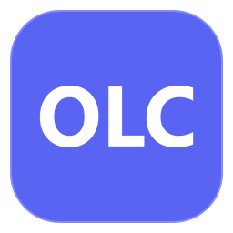
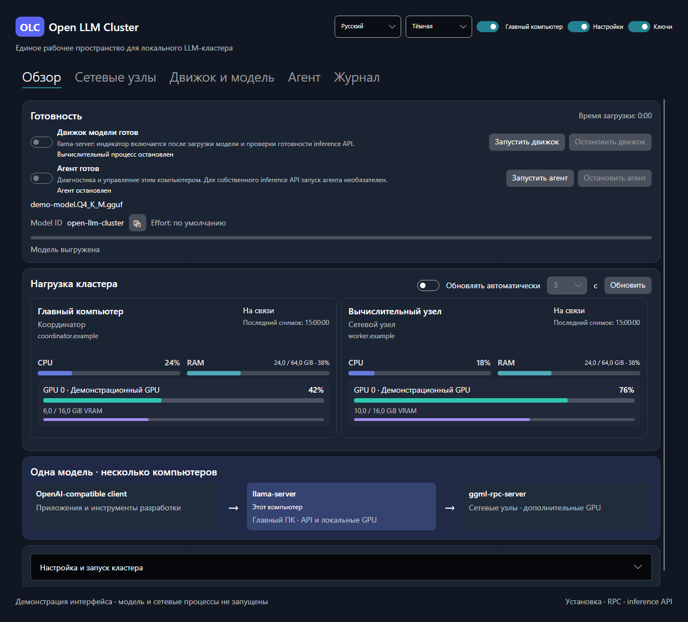

  

<h1 align="center">Open LLM Cluster</h1>

<strong>Несколько компьютеров. Одна локальная AI-модель.</strong>

  <a href="#быстрый-запуск">Начать</a> ·
  <a href="READEME-DEV.md">Подробное руководство</a> ·
  <a href="#документация">Документация</a>

Open LLM Cluster (OLC) помогает запустить языковую модель с использованием видеокарт нескольких компьютеров. Настройка, запуск и проверка связи доступны в одном приложении.

- Выбери главный компьютер и подключи остальные как сетевые узлы.
- Следи за загрузкой CPU, RAM и видеокарт на каждом ПК.
- Подключи свой чат или AI-агент — **OpenAI-compatible client**.

Интерфейс на русском и английском, светлая и тёмная темы. Распределённый запуск помогает разместить большую модель; скорость зависит от оборудования и сети.

## Как это выглядит

Тёмная тема, русский язык, демонстрационные данные. [Остальные скриншоты](READEME-DEV.md#скриншоты).

## Что понадобится

- Один или несколько компьютеров; для совместной работы — доверенная локальная сеть.
- Модель в формате **GGUF** на главном ПК и достаточно памяти для её загрузки. Модель скачивается отдельно.
- Готовая папка приложения с вложенным `Agent` либо [.NET SDK 10 для сборки из исходников](READEME-DEV.md#быстрый-запуск).

Работа проверялась на Windows. Поддержка Linux и macOS предусмотрена проектом, но требует проверки на этих ОС. [Полные требования](READEME-DEV.md#требования).

## Быстрый запуск

### 1. Запусти приложение

Если готовой сборки нет, выполни [инструкцию сборки из исходников](READEME-DEV.md#быстрый-запуск). Готовую папку Desktop копируй целиком, вместе с `Agent`, на каждый участвующий ПК. На Windows открой `OpenLLMCluster.Desktop.exe`.

На вкладке **«Движок и модель»** установи одну и ту же версию движка на всех ПК. Для видеокарт NVIDIA выбери **CUDA**.

### 2. Подключи компьютеры

На дополнительных ПК выключи переключатель **«Главный компьютер»** — они станут сетевыми узлами. На вкладке **«Агент»** настрой сетевой доступ и запусти агент, затем запусти движок узла.

На главном ПК добавь эти узлы на вкладке **«Сетевые узлы»** и проверь подключение. Настройка адресов, ключей и разрешений показана [пошагово в руководстве](READEME-DEV.md#запуск-кластера).

Если используешь только один ПК, оставь роль **«Главный компьютер»** и пропусти добавление узлов.

### 3. Загрузи модель

На главном ПК в **«Движок и модель»** выбери GGUF-файл. Для первого запуска начни с контекста **8192** и одного параллельного запроса. Нажми **«Запустить движок»** на странице **«Обзор»** и дождись готовности модели.

### 4. Подключи чат или AI-агент

В настройках OpenAI-совместимого подключения укажи:

| Поле | Что указать |
| --- | --- |
| Base URL | `http://<адрес-главного-ПК>:8080/v1`, если API-порт не менялся |
| API Key | Ключ inference API из настроек OLC |
| Model ID | Скопируй кнопкой у поля **Model ID** на карточке **«Готовность»** |

Для клиента на том же ПК используй адрес `127.0.0.1`. Для клиента на другом ПК настрой [сетевое прослушивание API и доступ к порту](READEME-DEV.md#затем-главный-компьютер).

Отправь короткий запрос, например: **«Ответь одним словом: READY»**.

## Если что-то не работает

- **Узел недоступен:** проверь запущенный агент, вычислительный RPC и разрешения сети — [инструкция](READEME-DEV.md#защищённое-сопряжение-и-управление-rpc).
- **Модель не загружается или отвечает медленно:** начни с меньшего контекста и посмотри журнал — [настройки и замеры](READEME-DEV.md#подбор-распределения-и-замеры).
- **Для сообщения об ошибке:** приложи версии OLC и движка, ОС и журнал без ключей и персональных данных.

## Документация

[Подробная настройка и разработка](READEME-DEV.md) · [Концепция](CONCEPT.md) · [Архитектура](ARCHITECTURE.md) · [Тестирование](TEST-Project.md) · [Задачи](TODO.md) · [Изменения](CHANGELOG.md)

Открытый проект под [лицензией MIT](LICENSE.md). Развивается в сотрудничестве Damian Morozov и Codex. [Как поучаствовать](READEME-DEV.md#участие-в-проекте).
